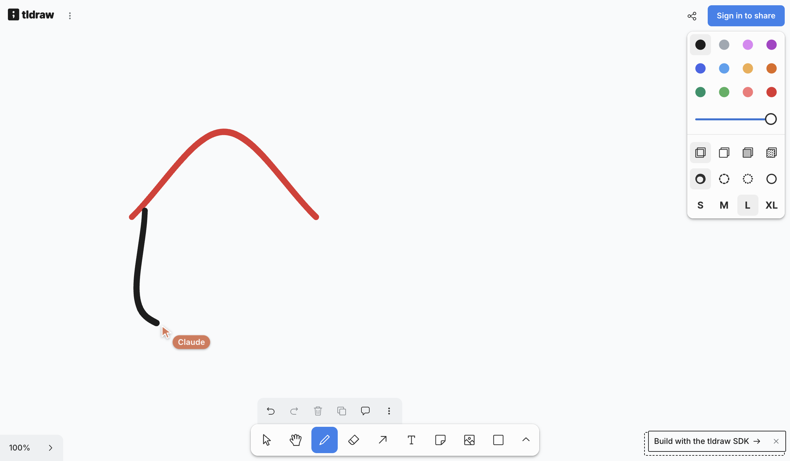

# tldraw WebMCP

A Chrome extension that turns an **already-open tldraw.com tab** into a WebMCP server, so an AI agent can draw with the pen, highlighter and eraser and create, edit, arrange and export shapes.

Verified 2026-11-02 against tldraw.com in Chrome 154: `node eval/run-eval.mjs` passes **23/23**. Output: `eval/final-scene.png`.

## How it works

```
tldraw.com tab
 └─ extension content script (world: MAIN — not blocked by tldraw.com's CSP)
     ├─ finds window.editor (undocumented tldraw.com global, resolved per call)
     └─ document.modelContext.registerTool(...)  ← native WebMCP
          ├─ pen / highlighter / eraser / laser → synthetic pointer events through editor.dispatch,
          │   so tldraw's own tools build the stroke (smoothing, pressure, stylus mode)
          └─ shapes / arrows / edits → editor.createShapes / updateShapes / createBindings
```

Strokes are drawn by *driving tldraw's own tools*, not by writing stroke records, because tldraw stores
draw strokes in a compressed base64 path format that changes between versions.

## Tools

| Tool | What it does |
|---|---|
| `tldraw_get_canvas` | Viewport (page coords), camera, tool, selection, every shape summarized. Read-only. |
| `tldraw_draw_strokes` | Instant strokes with no cursor: `eraser`, `laser`, or `draw`/`highlight` when the user asks for speed. Points `[x,y]` or `[x,y,pressure]`. |
| `tldraw_pen` | **Pen mode.** A few control points per stroke become a smooth curve (centripetal Catmull-Rom), drawn in real time while a labelled agent cursor glides between strokes and follows the pen. `speed`, `smooth` (call-wide or per stroke), `label` (default "Agent"). |
| `tldraw_create_shapes` | `geo` (20 kinds: rectangle, ellipse, star, …, with labels), `text`, `note`, `frame`, `line` (straight/cubic), `arrow` (bound to shapes, so it follows when they move). The Agent cursor draws each one like a person: boxes dragged corner to corner, arrows pulled, lines traced, labels typed (`animate: false` for big batches). |
| `tldraw_update_shapes` | Move, resize, rotate, recolor, relabel. The cursor grabs and drags moved shapes and pulls resize corners. Accepts exact labels as ids. |
| `tldraw_delete_shapes` | By ids, `"all"` or `"selected"`. Marked consequential (`consequentialHint`) so agents can confirm first. |
| `tldraw_arrange` | select, group, ungroup, align, distribute, bring_to_front, send_to_back. |
| `tldraw_view` | zoom_to_fit, zoom_to_shapes, set_camera, reset_zoom. |
| `tldraw_history` | undo / redo. One step per create/update/delete/arrange call, one per stroke for drawing tools. The stack is shared with the user. |
| `tldraw_export` | Same as tldraw's Export menu: PNG, SVG, JPEG or WebP, transparent background, padding, scale, dark mode, whole page or selected ids. Downloads the file in the user's browser, or returns it to the agent (SVG text or data URL) so it can inspect its work. |

Style enums are read from the live editor at registration time, so the schemas match the running tldraw version.
Every description states its coordinate system, return shape and failure behaviour, and the harder tools include an
example input, so smaller models can call them without trial and error.

### Agent skill

[`skills/tldraw-webmcp/SKILL.md`](skills/tldraw-webmcp/SKILL.md) teaches an agent the workflow (look → plan →
draw → check → show), which tool to pick, sizing rules and recipes (flowcharts, circles, sticky boards). Drop the
folder into `.claude/skills/` (or your agent's skill or prompt directory). It is also attached to every release.

### Pen mode



`tldraw_pen` sends pointer events through tldraw's own draw tool on animation frames at a steady speed, so
tldraw's velocity-based pressure and smoothing behave the same as for a hand-drawn stroke. The cursor is an overlay
drawn on top of the page (`pointer-events: none`), not the system mouse, so it never blocks the user.
Calls run one at a time, and your own style picker and tool are restored afterwards. Drawing continues in a
background tab, just batched more coarsely.

## Releases

Each release on the [Releases page](../../releases) has a `tldraw-webmcp-vX.Y.Z.zip`. Unzip it and use
**Load unpacked** in `chrome://extensions`.

CI (`.github/workflows/release.yml`) publishes a release whenever `extension/manifest.json` reaches `main`
with a version that hasn't been released yet. To ship: bump `"version"` and push.

## Run it

**With agent-browser (it already turns on WebMCP):**
```bash
agent-browser --extension ./extension open https://www.tldraw.com/
agent-browser webmcp list
agent-browser webmcp invoke tldraw_draw_strokes --params '{"strokes":[{"points":[[100,100],[200,150],[300,100]],"color":"red"}]}'
```

**From Claude Code (or any MCP client):** agent-browser's MCP server relays WebMCP tools (`agent_browser_webmcp_list/invoke`):
```bash
claude mcp add agent-browser -- agent-browser mcp --tools all
```
Then ask Claude to open tldraw.com with the extension (it needs the `--extension` flag, or set `AGENT_BROWSER_EXTENSIONS`) and draw.

**From Claude Code into your own open tab (no bridge):** Google's
[chrome-devtools-mcp](https://github.com/ChromeDevTools/chrome-devtools-mcp) exposes page WebMCP tools as
`list_webmcp_tools` / `execute_webmcp_tool` when started with `--categoryExperimentalWebmcp`, and attaches to the
Chrome you already have open with `--autoConnect` (or `--browserUrl http://127.0.0.1:9222`):
```bash
claude mcp add chrome -- npx chrome-devtools-mcp@latest --autoConnect --categoryExperimentalWebmcp
```
Your Chrome needs the extension loaded and WebMCP enabled (below). This path follows chrome-devtools-mcp's docs;
it has not been run end-to-end here yet.

**In your own Chrome:** WebMCP is experimental. Start Chrome with
`--enable-features=WebMCPTesting,DevToolsWebMCPSupport` (the flags agent-browser uses), then go to
`chrome://extensions` → Developer mode → Load unpacked → `extension/`. You also need an agent that consumes WebMCP in that
browser, such as Chrome's built-in agent or the MCP-B extension.

## Testing

Two layers:

- **`node eval/run-eval.mjs`** is deterministic and has no LLM. It drives every tool through WebMCP and checks the editor state directly.
  It also records the Agent cursor every frame and fails on any jump, and checks that off-screen work brings the camera along smoothly.
- **`node eval/real/run-real-test.mjs`** runs real agents. Text-only testers get a user prompt and the WebMCP tools, and never see an image:
  dummy `meta-llama/llama-3.1-8b-instruct`, medium `deepseek/deepseek-v4-flash`, and the cheap frontier tiers haiku `anthropic/claude-haiku-5.5` and luna `openai/gpt-5.6-luna`.
  Opus (`sota`, `anthropic/claude-opus-5.5`) is opt-in because it costs about 20-40x more per run.
  A vision judge (`google/gemini-3.8-flash`) marks a per-task checklist against a clean export of the board, and structural checks read the editor state.
  The tasks are in `eval/real/tasks.mjs`; models can be overridden with `TESTER_DUMMY`, `TESTER_MEDIUM`, `TESTER_HAIKU`, `TESTER_LUNA`, `TESTER_SOTA` and `JUDGE_MODEL`.
  ```bash
  OPENROUTER_API_KEY=... node eval/real/run-real-test.mjs --testers haiku,luna --tasks flowchart,smiley
  ```
  In CI, comment **`/run-real-test`** on an issue or PR (optionally `testers=haiku,sota tasks=smiley`) to get the scorecard back as a comment.
  The run fails only when a frontier tier (haiku, luna, or sota if included) misses a task; dummy and medium are measured, not gated.
  It needs the `OPENROUTER_API_KEY` repository secret.

Latest full run (2026-11-02, guide-tool mode, about $0.10 for 28 agent runs):

| | dummy (Llama 3.1 8B) | medium (DeepSeek v4 Flash) | haiku (Claude Haiku 5.5) | luna (GPT-5.6 Luna) |
|---|---|---|---|---|
| pass rate | 1/7 | **7/7** | **7/7** | **7/7** |
| tokens per task | 10k | 40k | 31k | 23k |

What the real agents taught the tools (each became a fix):
- Small models send arrays as JSON strings, guess ids from labels and send arrows without `from`/`to`.
  The tools now accept these and their errors list the real ids on the page.
- Agents built "a house" or "a smiley" from rectangles and ellipses. The descriptions and the guide now say that pictures are drawn with the pen.
- **Provider quality matters as much as the model.** DeepSeek v4 Flash served by DeepInfra (fp8) dropped tool arguments.
  Asked to make boxes green, it sent `text: ""`, `x: 0, y: 0` and no color, then looped create-delete for 20 turns (about 230k tokens per task).
  Fireworks, Azure and Parasail got the same request right 9/9, so the medium tier is pinned to them.

## Findings

1. **Feasible today.** `window.editor` exists on tldraw.com, `document.modelContext` is native in Chrome 154 with the flags above, and a MAIN-world content script can register tools for a site it doesn't own.
2. **Bad agent input can crash the user's board.** tldraw treats a store validation failure (e.g. `color: "not-a-color"`) as fatal: the editor stops handling input until reload. Every prop is therefore checked with tldraw's own validators *before* any store write. The eval asserts the editor never crashes.
3. **Stylus quirk:** tldraw turns off stylus mode if the first point's pressure is exactly `0`, so pressure is floored at 0.01.
4. **Injected text is inert:** labels go into tldraw's rich-text model and are never parsed as HTML (an `onerror` payload test passes).

## Limits / risks

- `window.editor` is **undocumented**. If tldraw removes it, the extension stops registering tools; it logs a console warning and does nothing else. Fallback idea, not built: walk React internals from `.tl-container`.
- WebMCP is at Intent-to-Experiment. The API already moved from `navigator.modelContext` to `document.modelContext`, and both are checked. No polyfill is bundled for browsers without WebMCP.
- Shapes created over a frame are not reparented into it.
- `line` is capped at 61 points; use `draw_strokes` for longer paths.
- The eval drives the tools directly. It has not yet been run with a separate LLM agent choosing the calls.
