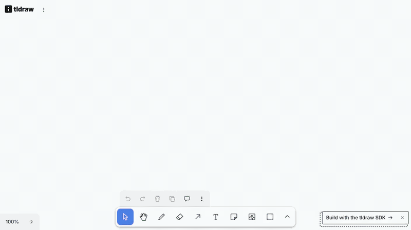
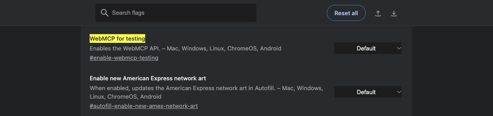
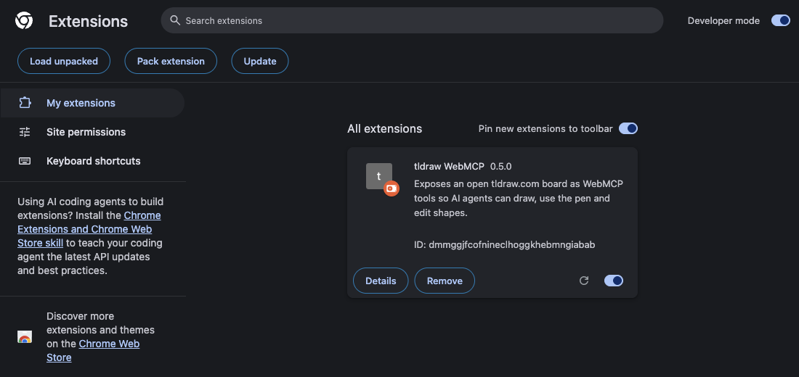
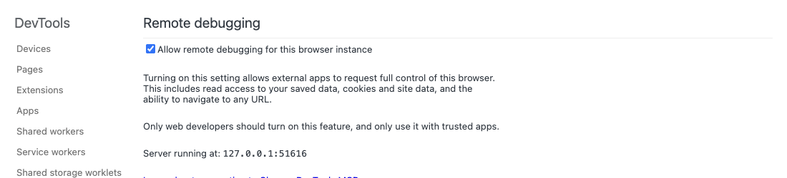
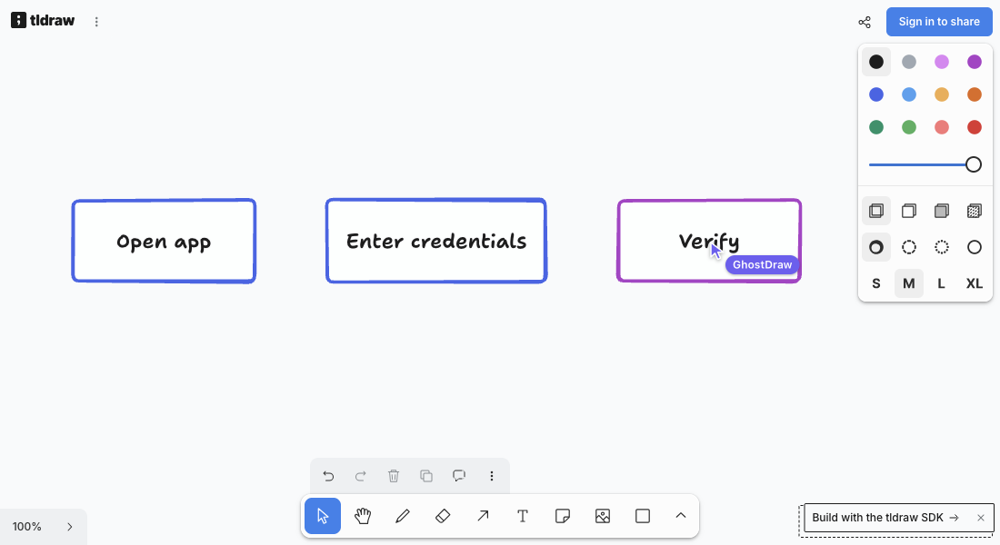

<p align="center">
  
</p>

<h1 align="center">GhostDraw</h1>

<p align="center">
  <b>AI agents draw on your tldraw.com board, while you watch.</b><br>
  A Chrome extension that gives Claude Code, Codex, DeepSeek and any MCP agent a hand on your board,<br>
  with a cursor you can see drawing every shape and pen stroke.
</p>

<p align="center">
  <a href="../../releases/latest"></a>
  <a href="../../actions/workflows/release.yml"></a>
  <a href="../../actions/workflows/real-test.yml"></a>
  <a href="LICENSE"></a>
</p>

<p align="center">
  
</p>

> GhostDraw is an independent project. It is not affiliated with or endorsed by tldraw, Inc.; "tldraw" is a trademark of tldraw, Inc.

## Why GhostDraw

- **Your board, not a copy.** It works in the tldraw.com tab you already have open, with your files, your sign-in and your shared rooms.
  The official tldraw MCP app, by contrast, gives the agent its own canvas inside the chat.
- **You watch it happen.** A labelled cursor drags boxes out corner to corner, pulls arrows, types labels and draws with tldraw's real pen.
  The camera follows when the work goes off-screen.
- **Works with any agent.** Tools are exposed through [WebMCP](https://github.com/webmachinelearning/webmcp), the browser standard for page tools.
  Desktop agents connect through Chrome's [chrome-devtools-mcp](https://github.com/ChromeDevTools/chrome-devtools-mcp); there is nothing to host.
- **Built for cheap models too.** It accepts the mistakes small models make, its errors say how to fix the call, and it ships its own guide.
  In CI, DeepSeek v4 Flash, Claude Haiku 5.5 and GPT-5.6 Luna each pass all 7 real drawing tasks ([details](docs/testing.md)).
- **Safe with your work.** Bad input is rejected before it can touch your board. Every agent call is one undo step, and delete is flagged so agents can ask first.

## Quick start

**1. Enable WebMCP.** Open `chrome://flags/#enable-webmcp-testing`, set **WebMCP for testing** to **Enabled**, and relaunch Chrome.



**2. Install GhostDraw.** Download `ghostdraw-vX.Y.Z.zip` from [Releases](../../releases/latest) and unzip it.
In `chrome://extensions`, turn on **Developer mode**, click **Load unpacked** and pick the unzipped folder.



**3. Let your agent reach Chrome.** Open `chrome://inspect/#remote-debugging` and tick **Allow remote debugging for this browser instance**.
This gives the connected agent control of this browser profile, so only connect agents you trust.



**4. Connect your agent** (below), open https://www.tldraw.com/, and ask for a drawing.
For example: *"On my tldraw tab, draw a login flowchart"* or *"sketch a house"*.



## Connect your agent

All agents use Chrome's MCP server: `--autoConnect` attaches to your running Chrome (144+), and `--categoryExperimentalWebmcp` turns on the page's WebMCP tools.
Approve the connection prompt in Chrome the first time.

<details open>
<summary><b>Claude Code</b></summary>

```bash
claude mcp add chrome-devtools -- npx chrome-devtools-mcp@latest --autoConnect --categoryExperimentalWebmcp
```
</details>

<details>
<summary><b>Codex</b></summary>

```bash
codex mcp add chrome-devtools -- npx chrome-devtools-mcp@latest --autoConnect --categoryExperimentalWebmcp
```
or in `~/.codex/config.toml`:
```toml
[mcp_servers.chrome-devtools]
command = "npx"
args = ["chrome-devtools-mcp@latest", "--autoConnect", "--categoryExperimentalWebmcp"]
```
</details>

<details>
<summary><b>DeepSeek, or any other agent harness</b></summary>

If your harness speaks MCP, add the same server:
```json
{ "mcpServers": { "chrome-devtools": { "command": "npx", "args": ["chrome-devtools-mcp@latest", "--autoConnect", "--categoryExperimentalWebmcp"] } } }
```
For your own tool-calling loop on a raw API, connect an MCP client to that server, then:
1. Call `list_webmcp_tools` and offer the tldraw tools to the model as functions.
2. Run each call with `execute_webmcp_tool` (`pageId`, `toolName`, and `input` as a JSON string).
3. Return the result text to the model.

[`runAgent` in eval/real/run-real-test.mjs](eval/real/run-real-test.mjs) is a working reference for that loop.
Use a provider that passes tool arguments through intact: one DeepSeek host dropped them in our tests ([details](docs/testing.md)).
</details>

Agents draw better after reading the built-in guide: ask them to call `tldraw_guide` first,
or install [`skills/ghostdraw`](skills/ghostdraw/SKILL.md) as a skill.

> **Status:** the tools are verified in Chrome 154 by both test layers.
> The desktop-agent chain (agent → chrome-devtools-mcp → your Chrome) follows Chrome's documentation but has not been run end to end yet.

## What agents can do

<details>
<summary><b>11 tools</b>, all prefixed <code>tldraw_</code></summary>

| Tool | What it does |
|---|---|
| `tldraw_get_canvas` | Read the board: visible area, camera, selection and a compact summary of every shape, with what each arrow connects. `points: true` adds each freehand stroke's path, so a text-only agent can tell what a sketch depicts. |
| `tldraw_guide` | The built-in guide (workflow, which tool to use, sizes, recipes, gotchas), generated from the skill. |
| `tldraw_pen` | **Pen mode, the default for drawing.** A few points per stroke become a smooth curve, drawn in real time by the cursor. |
| `tldraw_create_shapes` | Boxes and 20 geo kinds with labels, text, sticky notes, frames, lines, and arrows that stay attached to shapes. The cursor drags each one out. |
| `tldraw_update_shapes` | Move, resize, rotate, recolor, relabel. The cursor grabs and drags. Exact labels work as ids. |
| `tldraw_delete_shapes` | Delete by id, `"selected"` or `"all"`. Flagged as consequential so agents can ask first. |
| `tldraw_arrange` | Select, group, ungroup, align, distribute, bring to front, send to back. |
| `tldraw_draw_strokes` | Instant strokes with no cursor: the eraser, the laser pointer, or drawing when speed is asked for. |
| `tldraw_view` | Zoom to fit, zoom to shapes, set the camera, reset zoom. |
| `tldraw_history` | Undo and redo. One step per call (per stroke for drawing); shared with your own undo. |
| `tldraw_export` | PNG, SVG, JPEG or WebP, with transparent background, padding, scale and dark mode. Downloads the file, or returns it to the agent. |

Every description states coordinates, return values and failure behaviour, with example inputs for the harder tools.
Style values are read from the live editor, so they match the running tldraw version.
</details>

## How it works

```
your tldraw.com tab
 └─ GhostDraw content script (runs in the page)
     ├─ finds tldraw's editor (window.editor)
     └─ registers tools with document.modelContext  ← WebMCP
          ├─ pen, highlighter, eraser → pointer events through tldraw's own tools
          └─ shapes, arrows, edits   → tldraw's editor API, animated by the cursor
```

Strokes are drawn by *driving tldraw's own pen*, not by writing stroke records, so they get tldraw's real smoothing and pressure.
Every value is checked with tldraw's own validators before anything is written, because tldraw treats an invalid record as a crash of your board.

## Testing

| Layer | What it checks |
|---|---|
| `node eval/run-eval.mjs` | 24 deterministic checks, no LLM. Every tool, a crash-proof board, exports, and a cursor that never jumps (tracked every frame). |
| `node eval/real/run-real-test.mjs` | Real text-only agents draw 7 tasks; a vision model grades the result against a checklist. In CI, comment `/run-real-test` on an issue or PR. |

Latest real-agent run: DeepSeek v4 Flash, Claude Haiku 5.5 and GPT-5.6 Luna each **7/7**, for about $0.10 a run.
Methods, tiers, results and what real agents taught the tools: [docs/testing.md](docs/testing.md).

## Limitations

- **Relies on tldraw.com internals.** `window.editor` is not an official tldraw API; if it changes, GhostDraw stops registering tools until updated.
- **WebMCP is experimental** in Chrome (flag or origin trial), and its API is still changing.
- **Chrome only**, loaded unpacked for now; it is not on the Chrome Web Store.
- Shapes created over a frame are not placed inside it, and lines take at most 61 points (use the pen for longer paths).

## Development

```bash
node scripts/build-guide.mjs     # regenerate extension/guide.js after editing skills/ghostdraw/SKILL.md
node eval/run-eval.mjs           # deterministic suite (needs agent-browser)
OPENROUTER_API_KEY=... node eval/real/run-real-test.mjs --testers haiku,luna
```

Releases are automatic: bump `version` in `extension/manifest.json` and push to `main`.
The [release workflow](.github/workflows/release.yml) validates the extension, zips it and publishes `ghostdraw-vX.Y.Z.zip` with the skill attached.

## License

[MIT](LICENSE). The tldraw name and marks belong to tldraw, Inc. and are used here only to describe compatibility.
